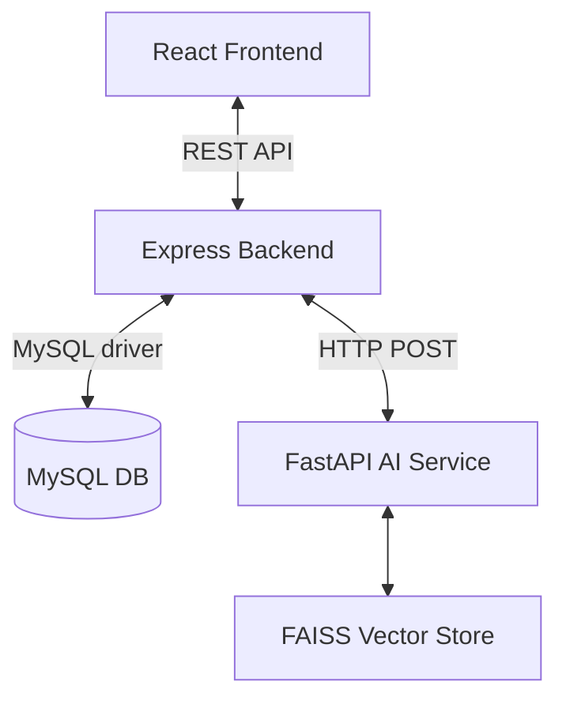

# Architecture

## Overview
- **Frontend**: React (Vite) + Tailwind CSS, interacting with Backend via Axios.
- **Backend**: Node.js + Express + MySQL handling CRUD and orchestrating matches.
- **AI Service**: Python + FastAPI hosting `all-MiniLM-L6-v2` with a FAISS vector index.

